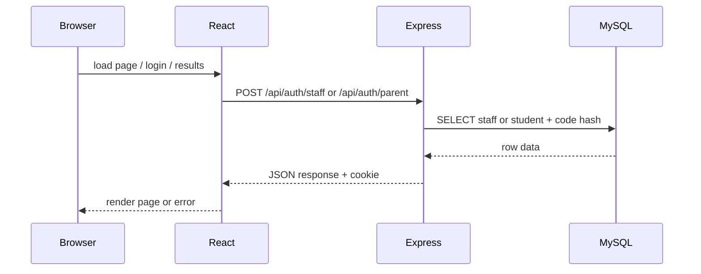

# Code Guide for this repository

## Table of contents

1. [Big picture](#1-big-picture)
2. [Node crash course](#2-node-crash-course)
3. [Express crash course](#3-express-crash-course)
4. [Feature walkthroughs](#4-feature-walkthroughs)
5. [MySQL basics as used here](#5-mysql-basics-as-used-here)
6. [Frontend](#6-frontend)
7. [Deployment on shared hosting](#7-deployment-on-shared-hosting)
8. [Glossary, common errors, debug checklist, known gaps, exercises](#8-glossary-common-errors-debug-checklist-known-gaps-exercises)
9. [Verified against](#verified-against)

---

## 1. Big picture

This repo is a school results portal. The actual code in this working tree shows a small, working-in-principle portal with:

- a browser app in [client/src/App.tsx](../client/src/App.tsx)
- an API in [server/src/index.ts](../server/src/index.ts)
- login code in [server/src/auth.ts](../server/src/auth.ts)
- CSV import and access-code logic in [server/src/student-management.ts](../server/src/student-management.ts)
- schema definitions in [server/migrations/001_schema.sql](../server/migrations/001_schema.sql)
- JSON layout definitions in [server/layouts/primary.json](../server/layouts/primary.json) and [server/layouts/secondary.json](../server/layouts/secondary.json)

The repo is not a finished school system yet. It is a versioned prototype with some pieces implemented and some pieces intentionally left as design notes or planned work.

### Repo tree (relevant source tree)

```text
.
├── .env.example
├── .github/
├── client/
│   ├── package.json
│   ├── public/
│   │   └── .htaccess
│   └── src/
│       ├── App.tsx
│       └── index.css
├── docs/
│   ├── CODE-GUIDE.md
│   ├── layouts.md
│   └── sample-register.csv
├── package.json
├── server/
│   ├── layouts/
│   │   ├── primary.json
│   │   └── secondary.json
│   ├── migrations/
│   │   └── 001_schema.sql
│   ├── package.json
│   ├── scripts/
│   │   ├── run-migrations.js
│   │   └── seed.js
│   └── src/
│       ├── auth.ts
│       ├── auth.test.ts
│       ├── index.ts
│       ├── student-management.ts
│       └── student-management.test.ts
└── Build Prompts.md
```

Notes:

- There is no [server/src/config](../server/src/config) directory in this repo right now.
- The project instructions mention feature flags, but that module is not built yet.
- The repo contains generated build output in [client/dist](../client/dist) and dependencies in node_modules, but those are not the main learning material.

### Architecture diagram



### Life of one request

A request usually goes like this:

1. The browser loads the React app from the static client bundle.
2. The React page calls a route such as `/staff-login` or `/results` inside [client/src/App.tsx](../client/src/App.tsx).
3. A login form posts JSON to [server/src/index.ts](../server/src/index.ts), which mounts the auth app from [server/src/auth.ts](../server/src/auth.ts).
4. Express validates request data with Zod and checks the database.
5. MySQL returns a row or rows from tables created by [server/migrations/001_schema.sql](../server/migrations/001_schema.sql).
6. Express sends a JSON response and maybe a secure cookie.
7. React renders the next screen using that response.

Important: the browser app in this repo is not yet fully connected to a real backend for every action. Some pages are hard-coded sample data, especially the results page.

---

## 2. Node crash course

### What Node is

Node.js is a JavaScript runtime that runs outside the browser. It is useful for building servers, CLIs, and tooling. In this repo, Node is used to run the Express API from [server/src/index.ts](../server/src/index.ts).

### Modules: import vs require

This repo uses ES modules in the server:

```ts
import express from 'express';
import dotenv from 'dotenv';
```

That is the modern `import` style. In older CommonJS files, you would see `require('express')`, but this repo uses `type: "module"` in [server/package.json](../server/package.json), so `import` is the normal pattern.

### npm and package.json scripts

The project root [package.json](../package.json) defines workspaces:

```json
"workspaces": ["client", "server"]
```

That means the repo can run commands across both apps. For example:

- `npm run dev` runs dev scripts in both workspaces
- `npm run build` runs both builds
- `npm --prefix server run test` runs the server tests

In [server/package.json](../server/package.json), the important scripts are:

```json
"dev": "tsx watch src/index.ts",
"build": "tsc",
"start": "node dist/index.js",
"test": "vitest run"
```

This tells Node and TypeScript how to run the server.

### Environment variables and .env

The repo has [.env.example](../.env.example). It is a template for values the app needs at runtime, such as:

```env
PORT=4000
DB_HOST=127.0.0.1
DB_NAME=school_portal
SESSION_SECRET=replace-with-a-random-secret
```

The code loads this file with `dotenv` inside [server/src/index.ts](../server/src/index.ts):

```ts
dotenv.config({ path: path.resolve(process.cwd(), '..', '.env') });
```

That means the app expects a real `.env` file next to the repo root, but it is not committed to version control.

### Promises and async/await

A promise is a value that will arrive later. Async code is used heavily in the server when talking to MySQL.

Example from [server/src/auth.ts](../server/src/auth.ts):

```ts
const user = await repo.findStaffByEmail(email);
const passwordMatches = await bcrypt.compare(password, user.passwordHash);
```

This is a plain way to say: “wait for the database query to finish, then continue.” Without `await`, the code would run before the data is ready.

### The event loop in plain words

Node is single-threaded at the application level, but it handles many requests efficiently by using the event loop. In plain English:

- Node starts the program.
- A request arrives.
- Node does the I/O work, such as database queries.
- While waiting for the database, Node can continue handling other work.
- When the database responds, Node resumes the callback or async function.

This is why Node works well for APIs and chat-style systems, but it is not the same as a CPU-heavy worker pool.

The event loop matters here because many routes in [server/src/auth.ts](../server/src/auth.ts) are asynchronous and interact with MySQL.

---

## 3. Express crash course

Express is a small web framework for Node. It does the job of receiving HTTP requests and sending HTTP responses. The main server entry point is [server/src/index.ts](../server/src/index.ts).

### app, routes, req/res

The app is created like this:

```ts
const app = express();
```

Then the app exposes routes such as:

```ts
app.get('/health', (_req, res) => {
  res.json({ ok: true, service: 'school-results-portal-api' });
});
```

In Express:

- `req` means the incoming request
- `res` means the outgoing response
- `next` means “continue to the next middleware or route”

### Middleware and why order matters

Middleware runs in order. In [server/src/index.ts](../server/src/index.ts):

```ts
app.use(helmet({ ... }));
app.use(express.json({ limit: '1mb' }));
app.use(createAuthApp());
```

This matters because:

- helmet adds headers for security
- JSON parsing must happen before route handlers expect JSON
- auth routes are attached after the middleware has been set up

If the app tried to parse JSON after the route handler, the handler would receive raw body data or do the wrong thing.

### Routers

The auth routes are not a separate file for a full router module; instead, the app creates a mini Express app inside [server/src/auth.ts](../server/src/auth.ts):

```ts
export function createAuthApp(options?: { repo?: AuthRepository }) {
  const app = express();
  app.post('/api/auth/staff', async (req, res) => { ... });
  app.post('/api/auth/parent', async (req, res) => { ... });
  return app;
}
```

This keeps authentication logic together and then mounts it in [server/src/index.ts](../server/src/index.ts) with `app.use(createAuthApp())`.

### Error handling

This app is simple and mostly uses a common pattern:

- validate input
- return a 401 or 403 response early
- avoid throwing unhandled errors

For example, in [server/src/auth.ts](../server/src/auth.ts) the code does:

```ts
if (!parsed.success) {
  return failAuth(req, res, repo, null);
}
```

This keeps the response consistent and prevents a crash triggered by malformed input.

### Cookies and sessions

The auth code sets a cookie named `school_portal_session` in [server/src/auth.ts](../server/src/auth.ts):

```ts
const cookieOptions = {
  httpOnly: true,
  sameSite: 'strict' as const,
  secure: process.env.NODE_ENV === 'production',
  path: '/',
  maxAge: 1000 * 60 * 60 * 8,
};
```

The cookie stores a JSON user object. It is read on each request and checked by middleware such as `requireStaff` and `requireParent`.

Why this is written this way:

- `httpOnly` stops JavaScript from reading the cookie
- `sameSite: strict` reduces cross-site request problems
- `secure` is better in production

### Helmet and CORS

Helmet is enabled in [server/src/index.ts](../server/src/index.ts):

```ts
app.use(helmet({
  contentSecurityPolicy: false,
  crossOriginResourcePolicy: false,
}));
```

Helmet adds useful security headers. The repo does not appear to configure a custom CORS allowlist in the server code; the browser app is local dev-only by default and the environment variable output suggests `CLIENT_ORIGIN` exists in [.env.example](../.env.example), but it is not used in the current server code.

UNSURE: whether CORS is fully implemented in production beyond the local dev setup.

### Validation with zod

The repo uses Zod for request validation in [server/src/auth.ts](../server/src/auth.ts):

```ts
const staffLoginSchema = z.object({
  email: z.string().trim().email(),
  password: z.string().min(6),
});
```

This says: if the request body is not a valid email and password, reject it before looking up the database. This reduces bad data, mistakes, and unnecessary queries.

---

## 4. Feature walkthroughs

### 4.1 Parent login

Files involved:

- [server/src/auth.ts](../server/src/auth.ts)
- [server/src/auth.test.ts](../server/src/auth.test.ts)
- [client/src/App.tsx](../client/src/App.tsx)

Flow diagram:

```text
browser form -> React -> POST /api/auth/parent -> Express -> MySQL lookup -> check code hash -> set cookie -> response
```

Example code (real, 12 lines):

```ts
const parentLoginSchema = z.object({
  admissionNumber: z.string().trim().min(3),
  accessCode: z.string().trim().min(6),
});

const student = await repo.findStudentByAdmissionNumber(subject);
const storedHash = await repo.findParentAccessCodeHash(student.id);
if (!storedHash || !(await bcrypt.compare(accessCode, storedHash))) {
  return failAuth(req, res, repo, subject);
}
```

Line by line:

- `parentLoginSchema` describes what a valid parent login body must look like.
- `findStudentByAdmissionNumber` looks up the student by admission number.
- `findParentAccessCodeHash` gets the current code hash for that student.
- `bcrypt.compare` checks the user input against the stored hash.

Why it is written this way:

- it does not reveal whether the exact admission number or code failed
- it keeps the return message generic
- it prevents logging in if the student is inactive

Security reason:

- a parent cannot log in with a guessed code
- failed login attempts are recorded for rate limiting
- the actual code hash is never stored in plain text in the app logic

### 4.2 Staff login

Files involved:

- [server/src/auth.ts](../server/src/auth.ts)
- [server/src/auth.test.ts](../server/src/auth.test.ts)
- [client/src/App.tsx](../client/src/App.tsx)

Flow diagram:

```text
staff form -> React -> POST /api/auth/staff -> Express -> lookup staff user -> compare password -> set staff cookie
```

Example code (real, 10 lines):

```ts
const user = await repo.findStaffByEmail(email);
if (!user) {
  return failAuth(req, res, repo, email.toLowerCase());
}

const passwordMatches = await bcrypt.compare(password, user.passwordHash);
```

Line by line:

- the system searches by email only, not by username
- a missing user triggers the generic auth error
- the password is checked with bcrypt, not by comparing strings directly

Why it is written this way:

- the registration flow is not fully implemented here, but the login is designed for hashed passwords and role-based access
- the app stores the roles in the `staff_users` table

Security reason:

- plain-text passwords are never compared
- a failed result is hidden behind the same generic error used for parent login

### 4.3 Rate limiting and lockout

Files involved:

- [server/src/auth.ts](../server/src/auth.ts)
- [server/src/auth.test.ts](../server/src/auth.test.ts)
- [server/migrations/001_schema.sql](../server/migrations/001_schema.sql)

Flow diagram:

```text
failed login -> record attempt -> check recent failures -> if >= 5 => deny access -> lockout persists for 15 minutes
```

Example code (real, 9 lines):

```ts
async function isLockedOut(repo: AuthRepository, subject: string | null, ipAddress: string): Promise<boolean> {
  const failedAttempts = await repo.countRecentFailedAttempts(subject, ipAddress);
  return failedAttempts >= 5;
}

await repo.recordLoginAttempt({ subject, ipAddress, success: false });
```

Line by line:

- `countRecentFailedAttempts` checks how many failed attempts happened in the recent time window
- the threshold is `5`
- `recordLoginAttempt` writes each failed attempt to the DB

Why it is written this way:

- the app is designed to limit repeated guessing attempts by subject and IP
- it matches the project brief’s requirement for rate-limiting without Redis

Security reason:

- the login attempts table is used for both admission number and IP tracking
- the system denies access before checking a password or code too many times

### 4.4 Access-code generation and hashing

Files involved:

- [server/src/student-management.ts](../server/src/student-management.ts)
- [server/src/student-management.test.ts](../server/src/student-management.test.ts)
- [server/scripts/seed.js](../server/scripts/seed.js)

Flow diagram:

```text
generate code -> hash code -> store hash -> parent logs in -> compare password/hash
```

Example code (real, 12 lines):

```ts
const ACCESS_CODE_ALPHABET = 'ABCDEFGHJKLMNPQRSTUVWXYZ23456789';

export function generateAccessCode(): string {
  let code = '';
  for (let index = 0; index < 8; index += 1) {
    code += ACCESS_CODE_ALPHABET[Math.floor(Math.random() * ACCESS_CODE_ALPHABET.length)];
  }
  return code;
}
```

Line by line:

- the alphabet excludes look-alike characters like `0`, `O`, `1`, `I`, `l`
- the code is 8 characters long
- the code is randomly generated each time

Why it is written this way:

- this matches the project requirement for access codes that are harder to confuse visually
- it is a simple, shared-hosting-friendly generation strategy

Security reason:

- the actual access code is not stored in plain text in the app code
- a login compares the input to a hashed value rather than storing raw values in the DB

### 4.5 Student import

Files involved:

- [server/src/student-management.ts](../server/src/student-management.ts)
- [server/src/student-management.test.ts](../server/src/student-management.test.ts)
- [docs/sample-register.csv](../docs/sample-register.csv)
- [client/src/App.tsx](../client/src/App.tsx)

Flow diagram:

```text
CSV upload -> parse headers -> validate required columns -> keep only stored fields -> preview -> add valid rows
```

Example code (real, 15 lines):

```ts
const headers = parseCsvLine(lines[0]).map((header) => header.trim().toLowerCase());
const requiredHeaderMap = {
  'first name': 'firstName',
  'last name': 'lastName',
  'admission number': 'admissionNumber',
  class: 'className',
  'parent phone number': 'parentPhone',
};

const missingHeaders = Object.keys(requiredHeaderMap).filter((header) => !headers.includes(header));
```

Line by line:

- the CSV is parsed by splitting the first row into headers
- required columns are checked case-insensitively and trimmed
- if a column is missing, the import fails early

Why it is written this way:

- only the stored fields are kept
- the application intentionally ignores extra columns like date of birth or religion
- matching by normalized headers prevents a brittle import from breaking on whitespace or uppercase differences

Security reason:

- it refuses bad data before storing anything
- it prevents writing unwanted personal data into the app

### 4.6 Results upload with preview

Files involved:

- [client/src/App.tsx](../client/src/App.tsx)
- [server/layouts/primary.json](../server/layouts/primary.json)
- [server/layouts/secondary.json](../server/layouts/secondary.json)
- [docs/layouts.md](../docs/layouts.md)

Flow diagram:

```text
CSV or Excel template -> preview rows -> validate -> show errors -> save to draft (planned)
```

This is a planned pattern in the repo brief and a partially implemented example in the browser UI. The code currently shows a preview and validation screen in the React app, but there is no real backend upload handler yet.

Example code (real, 15 lines):

```ts
const [preview, setPreview] = useState<Array<{ firstName: string; lastName: string; admissionNumber: string; className: string; parentPhone: string }>>([]);
const [errors, setErrors] = useState<string[]>([]);

if (missing.length > 0) {
  setErrors([`Missing required columns: ${missing.join(', ')}`]);
  setPreview([]);
  return;
}
```

Line by line:

- preview state stores the rows that pass validation
- errors state stores row-level failures
- the route blocks import if the required header set is missing

Why it is written this way:

- it mirrors a “preview-before-save” workflow
- it lets the admin correct the file before the system stores anything

Security reason:

- invalid input is rejected before saving
- only the final approved subset is saved in a real implementation

Note: actual database-backed result upload logic is not built yet.

### 4.7 Draft → approval → published

Files involved:

- [server/migrations/001_schema.sql](../server/migrations/001_schema.sql)
- [docs/layouts.md](../docs/layouts.md)

Flow diagram:

```text
uploaded batch -> status = draft -> principal/admin review -> status = published
```

The schema shows the state:

```sql
status ENUM('draft', 'published') NOT NULL DEFAULT 'draft'
```

This is present in the database model but not fully connected to a live route or UI in the current repo.

Why it is written this way:

- draft results are separated from final publication
- parents should only see published results

Security reason:

- it avoids exposing incomplete or unreviewed marks before approval
- it matches the repository brief’s requirement for parent visibility boundaries

### 4.8 Audit log

Files involved:

- [server/migrations/001_schema.sql](../server/migrations/001_schema.sql)

Flow diagram:

```text
admin action -> store actor + old value + new value -> audit_log row -> future review/debugging
```

The audit table is defined as:

```sql
CREATE TABLE IF NOT EXISTS audit_log (
  actor_id INT NULL,
  actor_role VARCHAR(50) NULL,
  entity_type VARCHAR(100) NOT NULL,
  entity_id INT NOT NULL,
  field_name VARCHAR(100) NOT NULL,
  old_value JSON NULL,
  new_value JSON NULL,
  created_at TIMESTAMP NOT NULL DEFAULT CURRENT_TIMESTAMP
);
```

Why it is written this way:

- it provides a record of who changed what, and when
- it supports traceability for admin corrections

Security reason:

- edits are tracked for accountability
- the system is easier to audit during reviews and incident response

### 4.9 Feature flags

Files involved:

- no real module exists in this repo at the moment
- project brief mentions flags in a configuration module, but there is no actual [server/src/config](../server/src/config) directory here

Flow diagram:

```text
feature flag off -> route hidden or returns 403 -> no UI is shown -> app behavior unchanged
```

This is part of the project brief, not the built repo. The project instructions explicitly say the flag module should live in one place and default to false, but this repo does not currently have this file.

This is a printed example of “not built yet.”

### 4.10 Layout JSON configs

Files involved:

- [server/layouts/primary.json](../server/layouts/primary.json)
- [server/layouts/secondary.json](../server/layouts/secondary.json)
- [docs/layouts.md](../docs/layouts.md)
- [client/src/App.tsx](../client/src/App.tsx)

Flow diagram:

```text
layout JSON -> React reads section definitions -> renders header / subjects / summary / comments
```

Real code excerpt (real, 15 lines):

```ts
const layout = primaryLayout as {
  sections: Array<{
    type: string;
    title: string;
    fields?: Array<{ key: string; label: string }>;
    columns?: Array<{ key: string; label: string }>;
  }>;
};

{layout.sections.map((section) => {
  if (section.type === 'header') {
```

Line by line:

- `primaryLayout` is imported from a JSON file
- the app reads `sections` from the config
- the app switches on `section.type` to render different block types

Why it is written this way:

- the project wants the report-card structure to be data-driven rather than hard-coded
- the same UI can adapt to multiple layouts and classes

Security reason:

- there is no hard-coded logic for each card layout to hide or show fields incorrectly
- configuration changes are easier to review and audit

### 4.11 Parent results page

Files involved:

- [client/src/App.tsx](../client/src/App.tsx)
- [server/layouts/primary.json](../server/layouts/primary.json)
- [server/layouts/secondary.json](../server/layouts/secondary.json)

Flow diagram:

```text
React route -> read layout config -> show student details -> render subject rows -> show summary -> show comments
```

Real code excerpt (real, 15 lines):

```ts
{layout.sections.map((section) => {
  if (section.type === 'subjects') {
    return (
      <section key={section.title} className="result-panel">
        <h3>{section.title}</h3>
        <table>
```

Line by line:

- the app iterates across the sections in the layout JSON
- subject rows are rendered in a table
- the fields are mapped dynamically from the config instead of a one-off layout

Why it is written this way:

- it lets the same page render different card shapes using config instead of duplicated markup
- this works well for a multi-layout school report-card system

Security reason:

- the UI is read-only for the parent flow in the current sample code
- the logic is intentionally simple and avoids dynamic calculation of averages or grades in the client

---

## 5. MySQL basics as used here

### The schema

The MySQL schema is in [server/migrations/001_schema.sql](../server/migrations/001_schema.sql). The most important tables are:

- `classes`
- `terms`
- `students`
- `staff_users`
- `access_codes`
- `result_batches`
- `result_rows`
- `audit_log`
- `login_attempts`

The key idea is that parent and staff access is separate. Students are tied to classes. Result batches are connected to a class and term. Access codes are stored as hashes.

### A real query from the code

This query appears in [server/src/auth.ts](../server/src/auth.ts):

```ts
const [rows] = await pool.execute<mysql.RowDataPacket[]>(
  'SELECT id, email, password_hash AS passwordHash, role FROM staff_users WHERE email = ? LIMIT 1',
  [email.toLowerCase()],
);
```

This is a parameterised query. The SQL is written first, and the input value is passed separately.

### Why parameterised queries matter

Without parameterisation, code like this is dangerous:

```sql
SELECT * FROM staff_users WHERE email = 'admin@x.com' OR '1'='1';
```

This is an example of SQL injection. It tries to force a condition that always becomes true. If the app concatenated user input into SQL strings, an attacker could change the meaning of the query.

In the actual repo, the pattern is:

```ts
'WHERE email = ?'
```

with an array of values:

```ts
[email.toLowerCase()]
```

The database driver treats the value as data, not SQL. That prevents the input from being executed as part of the query.

This pattern is used repeatedly in [server/src/auth.ts](../server/src/auth.ts) and [server/scripts/seed.js](../server/scripts/seed.js).

---

## 6. Frontend

### How React calls the API

The current frontend in [client/src/App.tsx](../client/src/App.tsx) is mostly a UI mock; it does not yet make real API calls for most flows.

For example, the login form does this:

```ts
const handleSubmit = (event: React.FormEvent<HTMLFormElement>) => {
  event.preventDefault();
  const formData = new FormData(event.currentTarget);
  const admissionNumber = String(formData.get('admissionNumber') ?? '').trim();
  const accessCode = String(formData.get('accessCode') ?? '').trim();

  if (admissionNumber === 'ADM-0001' && accessCode === 'CODE1234') {
    navigate('/results');
    return;
  }
```

This checks a hard-coded sample login, not a live network request. That is important to understand: the UI is demonstrating the user flow, but real authentication is in the server.

### Routing

The router is created with React Router in [client/src/App.tsx](../client/src/App.tsx):

```tsx
<BrowserRouter>
  <Routes>
    <Route path="/" element={<StaffLoginPage />} />
    <Route path="/staff-login" element={<StaffLoginPage />} />
    <Route path="/parent-login" element={<ParentLoginPage />} />
    <Route path="/results" element={<ParentResultsPage />} />
  </Routes>
</BrowserRouter>
```

This is the routing layer for the browser app.

### Protected routes

The repo does not yet implement a real protected-route system in the browser. The Express server uses middleware such as `requireStaff` and `requireParent` in [server/src/auth.ts](../server/src/auth.ts), but the browser does not currently read those cookies on every route or redirect to a login page automatically.

UNSURE: whether a full client-side guard is planned beyond the sample UI.

### Rendering from layout config

The parent results page reads section definitions from JSON and renders them dynamically. This is a strong example of configuration-driven UI.

```ts
const layout = primaryLayout as {
  sections: Array<{
    type: string;
    title: string;
    fields?: Array<{ key: string; label: string }>;
    columns?: Array<{ key: string; label: string }>;
  }>;
};
```

The code then maps over the `sections` array and renders:

- header blocks
- subject tables
- summary blocks
- comment blocks

This is why changing [server/layouts/primary.json](../server/layouts/primary.json) changes the page structure without changing React code.

---

## 7. Deployment on shared hosting

This repo is designed for a shared hosting model, not a Docker-heavy production setup.

### Build

The build commands are defined in [package.json](../package.json), [client/package.json](../client/package.json), and [server/package.json](../server/package.json):

- client build: `tsc -b && vite build`
- server build: `tsc`
- root build: `npm run build --workspaces --if-present`

The browser app builds to a static `dist` folder; the server builds to `dist/index.js` in the server package.

### .htaccess

The client uses [client/public/.htaccess](../client/public/.htaccess):

```apache
Options -Indexes
RewriteEngine On

RewriteCond %{REQUEST_FILENAME} !-f
RewriteCond %{REQUEST_FILENAME} !-d
RewriteRule ^ index.html [L]
```

This tells the static host to send unknown paths to `index.html`, which is necessary for client-side routing.

### Environment variables

The repo expects a real environment file that is not committed. The template is [.env.example](../.env.example). It includes database configuration and the API base URL.

The server loads the file with `dotenv` from [server/src/index.ts](../server/src/index.ts), and the migration script also does the same in [server/scripts/run-migrations.js](../server/scripts/run-migrations.js).

### How the Node app starts

The server entry file is [server/src/index.ts](../server/src/index.ts), which starts with:

```ts
const app = express();
const port = Number(process.env.PORT ?? 4000);

app.listen(port, () => {
  console.log(`Server running on port ${port}`);
});
```

This is the application startup pattern. On a shared host, the Node process would typically run from the server directory with the environment variables loaded from `.env`.

The repo is set up to work on a single Node process, which matches the hosting constraints in the project brief.

---

## 8. Glossary, common errors, debug checklist, known gaps, exercises

### Glossary

- API: application programming interface; the server route layer that receives and responds to requests
- Async: code that waits for something later, such as a database query
- Cookie: small text stored by the browser and sent back on later requests
- Hash: a transformed value used instead of a raw secret. It is one-way by design.
- Middleware: code that runs before the route handler and can inspect or change the request
- MySQL: the database in this repo
- Node: JavaScript runtime for server-side code
- React: the browser UI library
- Route: a URL path and its handler
- Zod: validation library used to check inputs

### Common errors and fixes

1. `Database environment variables are not configured.`
   - Fix: create a real `.env` file from [.env.example](../.env.example) and make sure the database exists.

2. `Invalid credentials or account locked.`
   - Fix: check that the request body is valid and look at the failed login logic in [server/src/auth.ts](../server/src/auth.ts).

3. `Missing required columns: ...`
   - Fix: compare the CSV header names to the expected names in [server/src/student-management.ts](../server/src/student-management.ts).

4. `No rows were provided for import.`
   - Fix: ensure the CSV has a header row and at least one data row.

5. React route does not load the expected page
   - Fix: confirm the route exists in [client/src/App.tsx](../client/src/App.tsx) and the static rewrite is handled by [client/public/.htaccess](../client/public/.htaccess).

### How to debug checklist

1. Start with the entry file: [server/src/index.ts](../server/src/index.ts).
2. Check `.env` values and confirm MySQL is listening.
3. Run the server tests: `npm --prefix server test`.
4. Add one small log statement or check a returned response in the route.
5. Verify that the request body matches the Zod schema.
6. Confirm the table names and column names match the migration.
7. For the browser app, verify routes in [client/src/App.tsx](../client/src/App.tsx).
8. When editing JSON layouts, check both the structure and the keys in the layout files.

### Known gaps

This repo is intentionally incomplete in several places. Some of these are visible from the code, not guesses:

- There is no real database-backed student import route in the server.
- There is no real result upload API beyond sample UI previews.
- There is no actual “publish results” route or approval flow connected to status changes.
- There is no real feature-flag module in [server/src/config](../server/src/config); the directory is absent.
- The browser app uses sample data for the parent results page instead of a production API fetch.
- The project instructions mention more admin flows, but they are not all implemented in this repo state.

### 10 small exercises

1. Change the sample login in [client/src/App.tsx](../client/src/App.tsx) and make the page say “Demo login.”
2. Update the access-code alphabet in [server/src/student-management.ts](../server/src/student-management.ts) and rerun the tests.
3. Add a new required header to the student CSV parser and see which tests fail.
4. Change the `maxAge` in the session cookie and explain the effect.
5. Change the lockout threshold from `5` to `3` in [server/src/auth.ts](../server/src/auth.ts) and revisit the test expectations.
6. Add a second section to [server/layouts/primary.json](../server/layouts/primary.json) and render it in the browser.
7. Change the sample names in [docs/sample-register.csv](../docs/sample-register.csv) to your own fake names and rerun the parser logic.
8. Read [server/scripts/seed.js](../server/scripts/seed.js) and note which tables it deletes before reseeding.
9. Change the route from `/results` to `/report` in [client/src/App.tsx](../client/src/App.tsx) and fix the link path.
10. Try a SQL injection string in a pure JavaScript example and compare it to the parameterised query pattern in [server/src/auth.ts](../server/src/auth.ts).

---

## Verified against

This guide was written from the actual code in these files:

- [package.json](../package.json)
- [.env.example](../.env.example)
- [client/package.json](../client/package.json)
- [client/public/.htaccess](../client/public/.htaccess)
- [client/src/App.tsx](../client/src/App.tsx)
- [client/src/index.css](../client/src/index.css)
- [docs/layouts.md](../docs/layouts.md)
- [docs/sample-register.csv](../docs/sample-register.csv)
- [server/package.json](../server/package.json)
- [server/migrations/001_schema.sql](../server/migrations/001_schema.sql)
- [server/layouts/primary.json](../server/layouts/primary.json)
- [server/layouts/secondary.json](../server/layouts/secondary.json)
- [server/scripts/run-migrations.js](../server/scripts/run-migrations.js)
- [server/scripts/seed.js](../server/scripts/seed.js)
- [server/src/index.ts](../server/src/index.ts)
- [server/src/auth.ts](../server/src/auth.ts)
- [server/src/auth.test.ts](../server/src/auth.test.ts)
- [server/src/student-management.ts](../server/src/student-management.ts)
- [server/src/student-management.test.ts](../server/src/student-management.test.ts)

This file intentionally avoids describing anything that is not present in this repo state.
